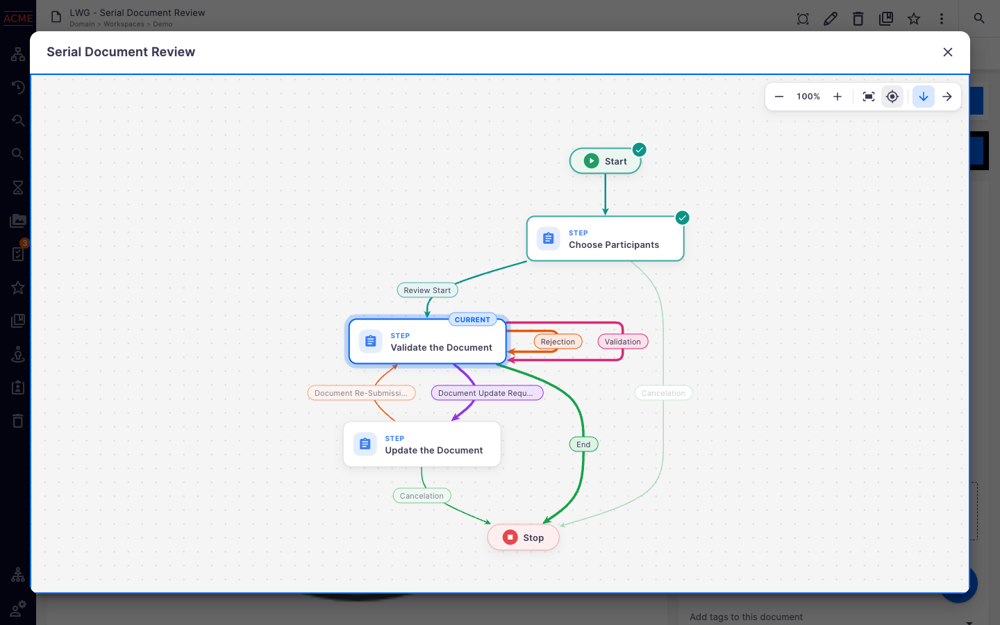
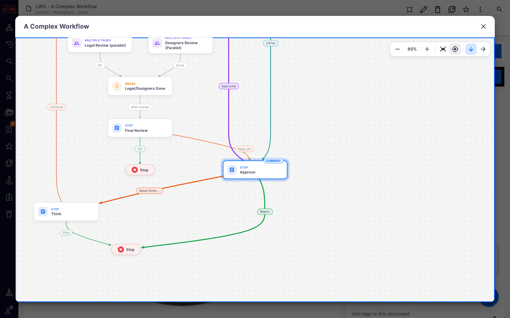
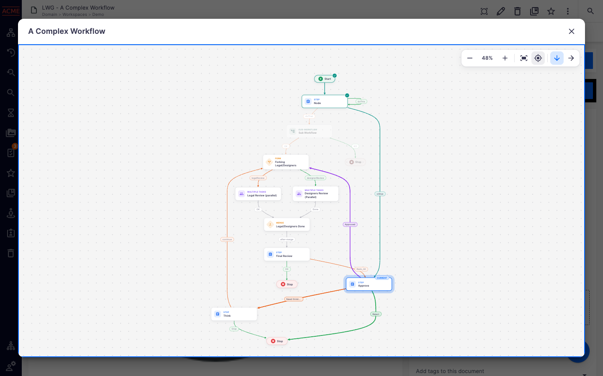
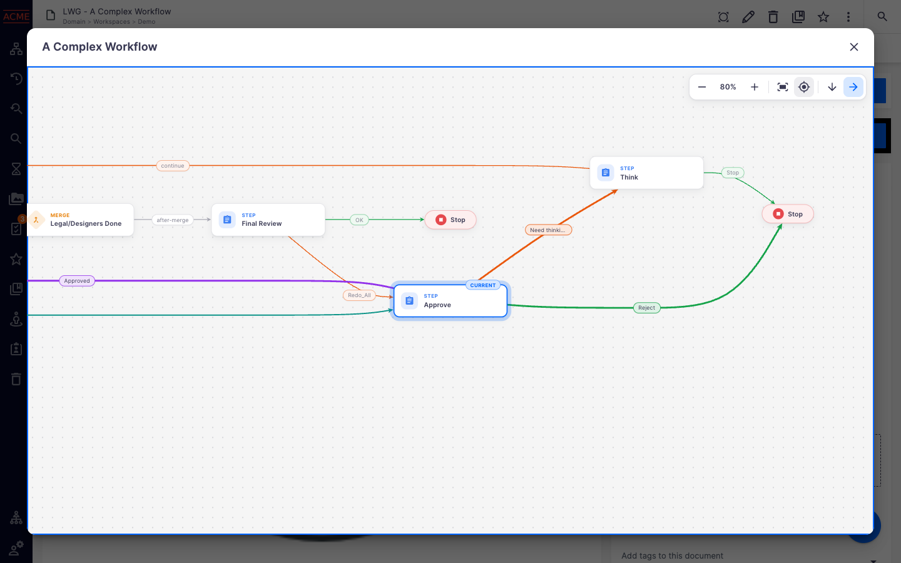
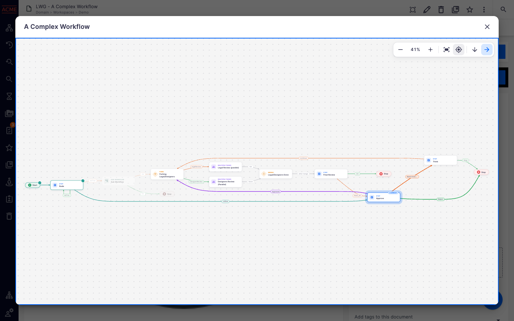
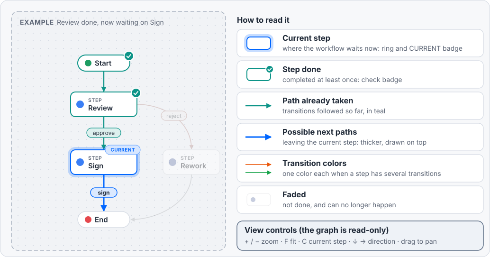
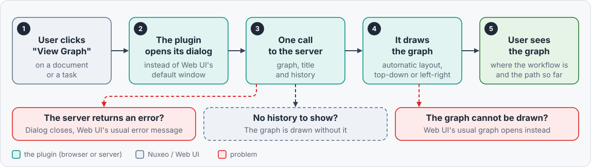
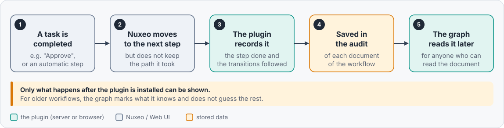

# Nuxeo Labs Workflow Graph

A clearer **"View Graph"** for the workflows of Nuxeo Web UI (Nuxeo LTS 2025): a modern, read-only picture of the
workflow, showing where it is now and which path it already took.



## Features

- **Replaces Web UI's "View Graph" dialog**, on the documents and on the tasks. No Web UI file is changed.
- **Automatic layout** ([dagre](https://github.com/dagrejs/dagre)), top to bottom or left to right. The drawing
  made in Nuxeo Studio is ignored.
- **Modern rendering**: cards with an icon per kind of step (step, multiple tasks, sub-workflow, fork, merge),
  Start/End pills, transition labels as chips, curved transitions.
- **Current step(s) highlighted**, with the transitions that can follow. Parallel branches can have several current
  steps.
- **History**: the steps already done and the transitions already followed are marked, the branches that can no
  longer happen are faded. The plugin records this history itself, from its installation on (see
  [How it works](#how-it-works)). It can be turned off.
- **Made for large workflows**: zoom, fit to screen, center on the current step, switch the direction (kept per
  workflow model).
- **Themes**: follows the Web UI theme (default, dark, Hyland light and dark). Colors can be changed with
  [CSS variables](#colors).
- **Translations**: English and French. Labels coming from the workflow definition are translated as in Web UI.
- **Safe**: if the graph cannot be drawn, Web UI's default graph opens instead.

| A large workflow opens zoomed on its current steps | `f`: the whole workflow (`c` goes back to the current step) |
| --- | --- |
|  |  |
| `→`: left to right | `f`: the whole workflow, left to right |
|  |  |

## How to read the graph



- **Transition colors**: as in Web UI's default graph, the transitions leaving a step that has several of them get
  different colors (5 colors, reused in turn). A single transition is neutral, or drawn in the highlight color when
  it leaves the current step.
- **The current look wins**: a current step that was already done (loop) is shown as current, and the transitions
  leaving it as next ones.
- **Faded branches** need the whole history, so they are only shown for the workflows started after the
  installation of the plugin. For an older workflow, the graph marks the steps done and the transitions followed
  since the installation, and fades nothing.
- **Opening**: the graph is fitted to the dialog. When it would then be displayed under 50%, the view zooms to 80% on
  the current step instead (press `f` to see the whole graph).

The exact rules are in [Development > Rules of the graph](docs/development.md#rules-of-the-graph).

## Keyboard, mouse and touch

| Action | Toolbar | Keyboard | Mouse / touch |
| --- | --- | --- | --- |
| Zoom in / out | `+` / `−` | `+` (or `=`) / `-` | pinch (touch screen, trackpad), Ctrl/⌘ + wheel |
| Fit to screen | fit button | `f` | |
| Center on the current step | target button | `c` (repeat to go to the next current step) | |
| Top to bottom / left to right | `↓` / `→` (the active one is highlighted) | `↓` / `→` (arrow keys) | |
| Pan | | | drag, wheel (Shift + wheel: horizontally) |
| Close | close button | `Escape` | |

The toolbar shows the zoom level (5% to 250%). The keys work once the graph has the focus: it has it when the
dialog opens, and after a click on the graph.

The direction is kept in the browser for each workflow model: a user can read one workflow top to bottom and another
one left to right, and every instance of a model (e.g. every "Serial Document Review") then opens the same way.

## How it works

The plugin has two parts: a new graph dialog **in the browser**, and a small history recorder **on the server**.

> [!TIP]
> For technical details (flow, implementation), see documentation at [docs](docs).

### When the user clicks "View Graph"



### How the history is recorded

Nuxeo does not remember which path a workflow took. Each time a step ends, the plugin writes the step and the
transitions followed in the audit of the documents of the workflow (event `lwgWorkflowStepCompleted`). The graph
reads it back.



### Good to know

- **Read-only**: nothing is clickable in the graph, it only shows.
- **Permissions**: the history is read from a document of the workflow that the user can read. As Nuxeo's graph
  endpoint does, the server reads the workflow itself with a privileged session, so the users who can read the
  document get its title even if they cannot read the workflow instance.
- **History tab**: the recorded entries also appear in the History tab ("Workflow step completed") and the Activity
  sidebar of the documents.
- **Lasting**: the entries stay in the audit, also once Nuxeo has cleaned up the finished workflows.
- **Can be turned off**: see [Stop recording the history](#stop-recording-the-history).
- **Depends on Web UI's internals**: to replace the dialog, the plugin patches Web UI's `nuxeo-workflow-graph`
  element through its shadow DOM. Unlikely, but a new version of Web UI could break it (see
  [Integration with Web UI](docs/development.md#integration-with-web-ui)).

More details:

- [Server side](docs/server-side.md): the recorder, the audit entries, the operation
  `LabsWorkflowGraph.GetWorkflowGraph`, the permissions and the limits.
- [Development](docs/development.md): the integration with Web UI, the failures, the exact rules of the graph, the
  architecture, the tests and the tools.

## Requirements and installation

- Nuxeo LTS 2025, **hotfix 2025.16 or later** (the recorder uses the audit routes added by this hotfix).
- Nuxeo Web UI (package `nuxeo-web-ui`).
- Cannot be installed together with `nuxeo-labs-custom-workflow-graph`, its interactive sibling.

The package is available in the Nuxeo Marketplace: add `nuxeo-labs-workflow-graph` to the dependencies of your
Studio project, or to the `NUXEO_PACKAGES` variable of a Docker deployment.

To build it yourself (Java 21, Maven 3.8+), see [Development > Build](docs/development.md#build), then install the
package:

```bash
nuxeoctl mp-install /path/to/nuxeo-labs-workflow-graph-package-<VERSION>.zip
```

> [!WARNING]
> Nuxeo may one day record the transitions followed by a workflow itself. **Check the release notes of this plugin
> before upgrading Nuxeo**: each completed step could then appear twice in the History tab of the documents (see
> [Server side](docs/server-side.md#if-nuxeo-records-the-transitions-one-day)).

## Colors

By default, the colors follow the Web UI theme. To change them, set CSS variables on `html`: the graph is drawn
inside shadow DOM, which regular CSS rules (e.g. `.lwg-node { border-color: red; }`) cannot reach, but CSS variables
can.

| Variable | Default | Used for |
| --- | --- | --- |
| `--lwg-current` | `--nuxeo-focus-ring-color`, else `--nuxeo-primary-color` | current steps (border, ring, badge), and the transition leaving a current step when it is its only one |
| `--lwg-passed` | `#0d9488` (teal) | steps already done (border, check badge) and transitions already followed, whatever their transition color |
| `--lwg-dimmed-opacity` | `0.4` | not a color: opacity of the faded branches, a number between 0 and 1 |
| `--lwg-transition-1` to `--lwg-transition-5` | `#16a34a` (green), `#ea580c` (orange), `#9333ea` (purple), `#db2777` (pink), `#0891b2` (cyan) | transitions of a step that has several of them, by rank in the step (the 6th one uses `-1` again) |
| `--lwg-edge` | mix of `--lwg-text` and `--lwg-bg` | transitions of a step that has a single one |
| `--lwg-color-start`, `--lwg-color-end` | `#1f9d63`, `#e5484d` | Start and End pills |
| `--lwg-color-step`, `--lwg-color-multi`, `--lwg-color-sub`, `--lwg-color-gateway` | `#3b7ff5`, `#8b5cf6`, `#0f9f96`, `#e8830c` | kinds of steps (icon and caption; gateway = fork and merge) |
| `--lwg-bg` | `--nuxeo-page-background` | canvas |
| `--lwg-card-bg` | `--nuxeo-box` | steps, labels and toolbar |
| `--lwg-text` | `--nuxeo-text-default` | text |
| `--lwg-grid` | mix of `--lwg-text` and `--lwg-bg` | dots of the canvas |

The other colors (borders, muted text, light tints of the labels, ring and badges) are computed from these. The icon
of the Start/End pills and the check of the steps already done are always white. The variables starting with
`--_lwg-` are internal: setting them has no effect.

Set the variables in the custom bundle of a Studio project (`nuxeo-<projectId>-custom-bundle.html`: for every
theme), or in a Web UI theme (`themes/<name>/theme.html`: for this theme only). For example:

```html
<custom-style>
  <style is="custom-style">
    html {
      --lwg-current: #c2410c;        /* current step */
      --lwg-passed: #4d7c0f;         /* steps already done, transitions already followed */
      --lwg-dimmed-opacity: 0.55;    /* faded branches: less faded */
      --lwg-transition-1: #15803d;   /* transitions of a step that has several of them */
      --lwg-transition-2: #b91c1c;
      --lwg-card-bg: #fffdf7;        /* steps */
      --lwg-bg: #f4f1ea;             /* canvas */
    }
  </style>
</custom-style>
```

To try values without deploying anything, open a graph and run in the browser console:

```js
document.documentElement.style.setProperty('--lwg-transition-1', 'crimson');
```

## Stop recording the history

The history is recorded by the listener `lwgStepCompletedListener`. To stop it, add an XML Extension in Studio:

```xml
<extension target="org.nuxeo.ecm.core.event.EventServiceComponent" point="listener">
  <listener name="lwgStepCompletedListener" enabled="false" />
</extension>
```

The entries already written stay in the audit and are still shown by the graph. To do it in a plugin, or to replace
the recorder with your own, see [Server side](docs/server-side.md#disabling-or-replacing-the-recorder).

## Third-party code

- [dagre](https://github.com/dagrejs/dagre) 3.1.3, MIT License (`vendor/dagre.LICENSE.txt`), unmodified
  `dist/dagre.min.js` (SHA-256 `54a503e346f93ca0bb10abe7999587e037262935687aca45eb4e4b0f64bbb578`).
- Material Icons by Google, Apache License 2.0 (SVG paths in `lwg-icons.js`).

## Support

**These features are not part of the Nuxeo Production platform.**

These solutions are not supported, and are provided for inspiration and we encourage customers to use
them as code samples and learning resources.

> [!TIP]
> If you need this feature,  **we strongly recommend a Nuxeo Partner or your dev team forks the code
> and takes ownership** (tuning, maintenance, support)

## License

[Apache License 2.0](http://www.apache.org/licenses/LICENSE-2.0)

## About Nuxeo

[Nuxeo](https://www.hyland.com/en/products/nuxeo-platform), developed by [Hyland](https://www.hyland.com),
is a Content Services platform. It provides an easy-to-use, highly customizable and extensible
architecture for building content-centric applications.
