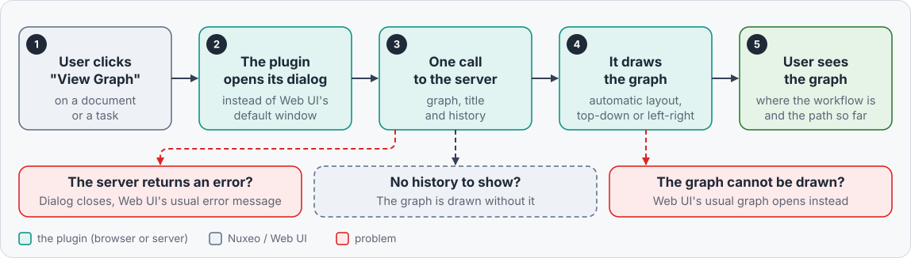

# Development

[README](../README.md) > Development

How the browser part works, the exact rules of the graph, the layout of the sources, the tests and the tools. The
server part (recorder, audit entries, operation) is described in [Server side](server-side.md).

- [Integration with Web UI](#integration-with-web-ui)
- [Data and failures](#data-and-failures)
- [Rules of the graph](#rules-of-the-graph)
- [Architecture](#architecture)
- [Tests and tools](#tests-and-tools)
- [Build](#build)

## Integration with Web UI

Web UI's default graph is the `nuxeo-workflow-graph` element (jsPlumb, fixed 880x720 canvas, Studio positions). It
is used by the document workflow bar and by the task view, which both only call its `show()` method. The element
cannot be redefined (`customElements.define` would throw), so the plugin **patches `show()`** once the element is
defined: the plugin's dialog is created inside the element's shadow root (where the default dialog lives) and the
original `show()` is kept as a fallback. No Web UI file is modified. Only the workflow id of the element is used: the
dialog gets everything else from the server.

> [!WARNING]
> The patch is done in
> [lwg-override.js](../nuxeo-labs-workflow-graph-web/src/main/resources/web/nuxeo.war/ui/nuxeo-labs-workflow-graph/lwg-override.js),
> which **uses the shadow DOM** of the original element: it depends on this structure, and the display **could break
> with a new version of nuxeo-web-ui**. This is very unlikely, but it is the only way to replace the original dialog
> without forking Web UI (and we don't want to fork Web UI).

Other details:

- A step is "current" when its state is `suspended` (waiting for its tasks), as in Web UI.
- The direction is stored only when the user chooses left to right, under the key
  `nuxeo-labs-workflow-graph.direction.model.<workflowModelName>` of the browser's local storage (going back to top
  to bottom removes it). Nothing is stored on the server, so the choice is per browser.
- The labels translated by the server use the language of Web UI.

## Data and failures

The data comes from one call to the operation `LabsWorkflowGraph.GetWorkflowGraph` of the plugin (see
[Server side](server-side.md#the-operation-labsworkflowgraphgetworkflowgraph)): the workflow (title of the dialog,
name of the workflow model), its graph (steps, kinds, states, transitions and their labels, as
`GET /api/v1/workflow/{id}/graph`) and its history (steps done, transitions followed), read from the audit of the
first attached document that the user can read. The graph is drawn once it has answered.



| Failure | Result |
| --- | --- |
| The operation fails (e.g. unknown workflow: 404) | the dialog closes and Web UI's usual error message is shown |
| The history cannot be read (no attached document the user can read, audit error) | the graph is drawn without the history (a warning is logged in the browser console, an audit error in the server log) |
| Layout or drawing error (or the plugin's dialog cannot be created) | Web UI's default graph is opened instead (the plugin's dialog is closed first) |

## Rules of the graph

**Current and next.** The current steps get a border, a ring and a "Current" badge; the ring keeps a minimum size
on screen at low zoom. The transitions leaving a current step are "next": thicker, bigger arrow heads, emphasized
labels, drawn on top. They keep their transition color; a single one is drawn in the highlight color.

**Transition colors.** The transitions of a step that has 2 or more get a palette color from their rank in the step
(definition order): `--lwg-transition-1` to `--lwg-transition-5`, reused in turn (7 transitions: 1, 2, 3, 4, 5, 1,
2). A single transition is neutral (`--lwg-edge`). The labels get a border and a light tint of the color; their text
keeps the text color, so it stays readable whatever the color. The color depends on the rank only, not on the meaning
of the transition: the graph REST endpoint gives no transition id, only its source, target and label.

**History.** The steps done (completed at least once, from the audit entries of the recorder) get a border and a
check badge, the transitions followed are drawn in `--lwg-passed`, a bit thicker, whatever their palette color.
**The current look wins**: a current step that was done before (loop) is shown as current, a transition leaving a
current step is shown as a next transition. Nothing is guessed: the transitions only come from the recorder.

**Branches not followed.** What was not done and cannot happen anymore is faded and grayed:

- a step is dimmed when it never started (not current, not waiting for other branches, not the target of a
  followed transition) **and** cannot be reached anymore: no transition leads to it from a current step (or from a
  merge waiting for other branches). The steps still to come keep their normal look;
- a transition is dimmed when it was never followed and cannot be followed anymore: its step is dimmed, or its
  step will not run again and its target never started. The current step and its transitions never change. A
  transition between two steps that were both reached is never dimmed, even if it was not recorded (the recorder
  never breaks a workflow, it may have failed).

Example, Parallel Document Review while the opinions are given: the Stop after "Cancelation" (Choose Participants
will not run again) is dimmed, the two Stops after "Consolidate the Review" are not. With a loop back to an earlier
step (e.g. "Changes requested" back to the preparation), everything after that step can happen again: nothing is
dimmed there. When the workflow is done, every step never reached is dimmed.

The dimming needs the whole history: it is only applied when a start step is recorded (or current), i.e. to the
workflows started after the installation. For a workflow started before, the steps done and the transitions followed
since are marked, nothing is dimmed. Without the history (no attached document can be read), nothing is marked nor
dimmed.

Drawing order of the transitions: dimmed, others, followed, next. Look of what is dimmed: the steps use
`--lwg-dimmed-opacity` (0.4 by default) and are grayed, their transitions 80% of it; the labels are faded as much but
stay opaque (their line passes below them).

**Opening.** The graph is fitted to the dialog. When it would then be displayed under 50% and a step is current,
the view zooms to 80% on the current step instead. Switching the direction resets the view the same way. Zoom range:
5% to 250%, step 1.25. No animation of any kind.

## Architecture

```
nuxeo-labs-workflow-graph-core/src/main/
├── java/nuxeo/labs/workflowgraph/
│   ├── StepCompletedListener.java     records the transitions followed (one audit entry per completed step, on
│   │                                  each attached document)
│   ├── GetWorkflowGraphOperation.java operation LabsWorkflowGraph.GetWorkflowGraph: workflow, graph and history
│   ├── WorkflowHistory.java           history of a workflow built from the audit entries of the recorder
│   └── WorkflowHistoryConstants.java  event name, audit extended info keys
└── resources/
    ├── META-INF/MANIFEST.MF
    └── OSGI-INF/
        ├── lwg-audit-contrib.xml       audited event and its extended info
        ├── lwg-listener-contrib.xml    the recorder
        └── lwg-operations-contrib.xml  the operation

nuxeo-labs-workflow-graph-web/src/main/resources/
├── META-INF/MANIFEST.MF
├── OSGI-INF/
│   ├── deployment-fragment.xml        copies the web resources, merges the translations
│   └── lwg-webresources-contrib.xml   registers the bundle HTML with Web UI
└── web/nuxeo.war/ui/
    ├── i18n/messages.json, messages-fr.json   labels of the graph, and of the audit entries (History, Activity)
    └── nuxeo-labs-workflow-graph/
        ├── nuxeo-labs-workflow-graph-bundle.html   entry point (script order)
        ├── lwg-core.js                namespace, directions (storage), translations, text measuring, model, history
        ├── lwg-layout.js              geometry helpers and the layout, top to bottom or left to right (dagre)
        ├── lwg-icons.js               inline SVG icons (Material Icons)
        ├── lwg-styles.js              CSS of the graph (no animation)
        ├── lwg-renderer.js            LWG.Renderer: drawing, zoom, pan, fit, center, direction (framework-free)
        ├── nuxeo-labs-workflow-graph-dialog.html   Polymer dialog: title, loading, graph (one call to the
        │                                            operation), direction memory
        ├── lwg-override.js            patch of nuxeo-workflow-graph.show()
        └── vendor/dagre.min.js        dagre 3.1.3 (MIT), unmodified
```

Plain JavaScript and HTML imports, like Web UI add-ons built without a JS toolchain: no npm build is needed and the
Maven build only packages the files. The Java bundle has no dependency other than Nuxeo.

The images of the README are in `README-Images/`: screenshots (PNG) and diagrams (SVG, hand-written, light theme with
an opaque background so they read well in GitHub's light and dark themes). When the behavior they show changes
(failures, history, legend), update the matching SVG too.

## Tests and tools

The `dev/` folder is not packaged. Nothing is installed by the project: the browser tool uses an existing
`node_modules` folder and an existing Chrome.

### Unit tests (JavaScript)

```bash
node --test dev/test
```

Node 20+, no dependency. They cover:

- the directions and their storage, the translations;
- the model: transition colors, history in the format of the operation;
- the geometry and the layout: every sample in both directions, steps placed without overlap, transitions attached
  to their steps, labels off the steps.

### Demo

```bash
python3 -m http.server 8765
```

Then open `http://localhost:8765/dev/demo/index.html`: the renderer with the sample workflows, themes and languages.
URL parameters: `wf`, `theme`, `lang`, `dir` (`TB` or `LR`, forces the direction, otherwise it is kept per sample as
in the dialog), `history=off` (hides the history). Example: `dev/demo/index.html?wf=large&theme=dark`.

### Screenshots and interaction checks

```bash
export LWG_NODE_MODULES=/path/to/node_modules        # must contain puppeteer-core
export CHROME_PATH=/path/to/chrome-headless-shell    # optional, defaults to Google Chrome on macOS
node dev/tools/screenshots.mjs [filter]              # filter "checks": interaction checks only
```

Renders every sample in every theme (and left to right) in headless Chrome and writes `dev/out/demo/*.png`, then
checks the interactions. Fails on any console error or warning. Checked:

- initial view (zoom on the current step for a large graph), `F`, `C` (cycling), `+`, `-`, minimum zoom, toolbar,
  Ctrl + wheel, wheel, drag;
- no animation, steps not focusable;
- transition colors, color overrides;
- history: steps done, transitions followed, branches not followed, steps still to come not dimmed, sizes, drawing
  order, `--lwg-passed`, `--lwg-dimmed-opacity`;
- direction switch: toolbar and `↓` / `→` keys, view reset, kept per workflow, not stored for TB.

### Java tests

Run by `mvn clean install` (JUnit 4, in-memory audit). Add `-Dnuxeo.test.audit=sql` to run them with the SQL audit
backend (H2):

```bash
mvn -pl nuxeo-labs-workflow-graph-core test -Dnuxeo.test.audit=sql
```

They cover:

- **the recorder**: entries written on the attached document (values of every key, JSON as returned by the REST API,
  nothing on the workflow instance) on a simple path, a loop, a fork and merge, a merge waiting for another branch,
  "execute only the first transition", a step with several tasks, a canceled workflow, several attached documents,
  an attached document deleted while the workflow runs, a workflow without attached document, the length of the
  audit comment, the recorder disabled;
- **the operation**: workflow fields, graph identical to Nuxeo's, history and its JSON, loops and counts, other
  workflows of the document ignored, a reader of the document who cannot read the workflow, a user who cannot read
  the documents, the first readable attached document, a deleted attached document, no attached document, unknown
  ids and non-workflow documents answered the same way, language;
- **the history built from audit entries**: order, counts, other workflows and events, values of other types.

### Samples

`dev/demo/samples.js`: SerialDocumentReview, ParallelDocumentReview and MainWF rebuilt from the Nuxeo sources, plus
two synthetic workflows: "contract" (fork, merge, loops, sub-workflow, long titles) and "large" (59 steps, two
current steps in parallel branches). Each one has a history, in the format returned by the operation (the Java tests
cover how the operation builds it from the audit entries).

## Build

Java 21, Maven 3.8+:

```bash
cd /path/to/nuxeo-labs-workflow-graph
mvn clean install
```

The marketplace package is produced at
`nuxeo-labs-workflow-graph-package/target/nuxeo-labs-workflow-graph-package-<VERSION>.zip`.
