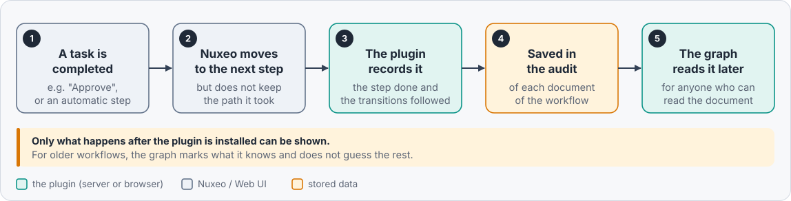

# Server side

[README](../README.md) > Server side

Nuxeo does not keep the path followed by a graph workflow: the graph endpoint only tells which steps are current (a
step that is done goes back to the `ready` state, like a step never reached), the result of a transition is reset
as soon as its target step starts, and Nuxeo removes the done and canceled workflow instances with its daily cleanup.

So the plugin adds a small Java bundle, `nuxeo-labs-workflow-graph-core`, with:

- a **recorder** that writes the steps done and the transitions followed **in the audit of the documents attached
  to the workflow**;
- an **operation**, `LabsWorkflowGraph.GetWorkflowGraph`, that returns everything the graph draws in one call.



- [The recorder](#the-recorder)
- [Who can see the entries](#who-can-see-the-entries)
- [The operation `LabsWorkflowGraph.GetWorkflowGraph`](#the-operation-labsworkflowgraphgetworkflowgraph)
- [Limits](#limits)
- [Disabling or replacing the recorder](#disabling-or-replacing-the-recorder)
- [If Nuxeo records the transitions one day](#if-nuxeo-records-the-transitions-one-day)

## The recorder

From the installation on, a synchronous listener (`beforeDocumentModification`) detects that a step completes (the
workflow engine saves it with a new `rnode:endDate`, right after evaluating its transitions) and records the
transitions it follows: one audit entry per completed step, on **each** attached document (the ones that still
exist; nothing is recorded for a workflow without attached document):

| Field | Value |
| --- | --- |
| `eventId` | `lwgWorkflowStepCompleted` |
| `category` | `Routing` |
| `docUUID` | id of the attached document |
| `comment` | readable summary, e.g. `Task6d8 -> Task5c1 (sdr_finishTask6d8)`, abbreviated to 1000 characters |
| `extended.lwgWorkflowId` | id of the workflow instance |
| `extended.lwgModelName` | name of the workflow model, e.g. `SerialDocumentReview` |
| `extended.lwgNodeId` | id of the completed step |
| `extended.lwgTransitions` | positions of the followed transitions in the step (definition order, the order of the graph endpoint), list of numbers, empty for an end step |
| `extended.lwgTransitionNames` | names of the followed transitions, same order |
| `extended.lwgTargets` | ids of their target steps, same order |

As returned by `GET /api/v1/id/{docId}/@audit?eventId=lwgWorkflowStepCompleted` (shortened):

```json
{
  "entity-type": "logEntry",
  "category": "Routing",
  "principalName": "jdoe",
  "comment": "Task6d8 -> Task6d8 (sdr_validationTask6d8)",
  "docUUID": "1b2c3d4e-...",
  "eventId": "lwgWorkflowStepCompleted",
  "eventDate": "2026-11-09T10:15:30.123Z",
  "extended": {
    "lwgWorkflowId": "9f8e7d6c-...",
    "lwgModelName": "SerialDocumentReview",
    "lwgNodeId": "Task6d8",
    "lwgTransitions": [3],
    "lwgTransitionNames": ["sdr_validationTask6d8"],
    "lwgTargets": ["Task6d8"]
  }
}
```

The extended info keys start with `lwg`: in the OpenSearch audit backend, the extended info of every event share one
mapping, a generic name could clash with the one of another add-on, or of a future version of Nuxeo. Each key always
holds the same type.

The listener does not break a workflow: an error is logged and the workflow goes on, unless the transaction fails
anyway (concurrent update, interrupted thread, transaction already marked for rollback), where the error is
rethrown, as Nuxeo's event service does. Besides the fields above, the audit fills the ones of every entry (date,
user who completed the step, path, type and state of the document). Nothing else is stored: no task comment, no
workflow or step variable.

## Who can see the entries

The users who can read the document: the operation (below) checks `READ` on the document with the user's session,
as Web UI's History tab (`GET /api/v1/id/{docId}/@audit`) requires, before reading its audit.

The entries also appear in the **History** tab and in the **Activity** sidebar of the document. The plugin adds
their labels to Web UI's translations (English and French): "Workflow step completed" (History), "completed a
workflow step" (Activity), and "Workflow" for the `Routing` category, which Web UI otherwise displays as a raw key,
also for its own workflow events.

There is no setting to hide them: they are regular audit entries of the documents.

## The operation `LabsWorkflowGraph.GetWorkflowGraph`

Called by the graph dialog, it returns a JSON blob with everything the graph draws:

| Parameter | Description |
| --- | --- |
| `workflowId` | id of the workflow instance (required) |
| `language` | language of the labels translated by the server, e.g. `fr` or `fr-FR` (optional, English by default; the dialog sends the language of Web UI) |

Response (shortened):

```json
{
  "workflow": {
    "id": "9f8e7d6c-...",
    "name": "SerialDocumentReview",
    "title": "wf.serialDocumentReview.SerialDocumentReview",
    "state": "running",
    "workflowModelName": "SerialDocumentReview"
  },
  "graph": { "nodes": ["..."], "transitions": ["..."] },
  "history": {
    "nodes": [{ "id": "Task6d8", "completed": true, "count": 2 }],
    "transitions": [
      { "source": "Task6d8", "index": 3, "name": "sdr_validationTask6d8", "target": "Task6d8", "count": 1 }
    ],
    "truncated": false
  }
}
```

- `workflow`: the fields of `GET /api/v1/workflow/{id}` used by the graph.
- `graph`: as `GET /api/v1/workflow/{id}/graph`.
- `history`: the steps completed at least once and the transitions followed at least once (`index`: position in the
  step, definition order), with their counts, from the audit entries of the recorder for this workflow; `null` when
  no attached document can be read by the user, or when the audit cannot be read (logged on the server).

**Permissions.** As Nuxeo's graph endpoint does, the workflow is read with a privileged session: the users who can
read the attached documents but not the workflow instance (`GET /api/v1/workflow/{id}` answers 403 to them) get its
title and model name too. Only workflows are read this way: any other id is answered as an unknown workflow (404),
whether the document exists or not. The ids of the attached documents are never returned: they are only used to find
the first one the user can read (`READ`, checked with the user's session), whose audit holds the history.

**Audit backends.** The backends that can filter on extended info (OpenSearch, MongoDB) return the entries of this
workflow only; with the SQL backend, the entries of every workflow of the document are read and filtered by the
operation.

## Limits

- Only what happened after the installation is known: a workflow started before shows the steps done and the
  transitions followed since, and nothing is dimmed (the dimming needs the whole history).
- The workflow engine evaluates the transitions with the variables of the moment: the recorded transitions are
  the ones it actually followed, a button alone would not tell (several transitions can share a button).
- With loops, a step done several times is marked once (the entries give the counts, the graph does not show them).
- The audit entries are written asynchronously, after the transaction commits: the last step may show up a moment
  after the task is completed.
- One entry per attached document: a workflow on 3 documents writes 3 identical entries per completed step, on
  their 3 audits.
- The operation reads at most 10,000 entries of the event per document (most recent first): for a document with
  more, the oldest ones are ignored (`truncated` is true, a warning is logged on the server and in the browser
  console). It checks at most the first 1,000 attached documents to find one that the user can read.
- The plugin deletes nothing: the entries stay in the audit of the documents, as any audit entry, also once Nuxeo has
  removed the workflow instance (Web UI only opens the graph of the running workflows, though).

## Disabling or replacing the recorder

The recorder is the listener `lwgStepCompletedListener` (component `nuxeo.labs.workflowgraph.listener`), overridden
as any Nuxeo listener: add `enabled="false"`.

*Stop recording* with an XML Extension in Studio:

```xml
<extension target="org.nuxeo.ecm.core.event.EventServiceComponent" point="listener">
  <listener name="lwgStepCompletedListener" enabled="false" />
</extension>
```

*Stop recording* with an XML contribution in a plugin:

```xml
<component name="com.example.workflowgraph.recorder.disabled">
  <require>nuxeo.labs.workflowgraph.listener</require>
  <extension target="org.nuxeo.ecm.core.event.EventServiceComponent" point="listener">
    <listener name="lwgStepCompletedListener" enabled="false" />
  </extension>
</component>
```

No audit entry is written anymore (the audit contribution of the plugin can stay, it only declares the event).
The entries already written stay in the audit of the documents and are still shown by the graph; the steps done
and the transitions followed afterwards are unknown, as before the installation.

*Use your own recorder*: same `<listener name="lwgStepCompletedListener" class="com.example.MyRecorder" />` (the
events are kept). It must stay synchronous (an `EventListener`: the results of the transitions are reset as soon
as the next step starts) and, for the graph to draw the history, fire `lwgWorkflowStepCompleted` on the attached
documents with the event properties `lwgWorkflowId`, `lwgModelName`, `lwgNodeId`, `lwgTransitions`,
`lwgTransitionNames` and `lwgTargets` (the audit contribution of the plugin stores them as the extended info of
[the table above](#the-recorder)). It can extend `StepCompletedListener` (`handleEvent`, `record`, `properties`).

## If Nuxeo records the transitions one day

> [!WARNING]
> Nuxeo does not record the transitions followed by a workflow, so the plugin records them itself, in its own audit
> event (`lwgWorkflowStepCompleted`). Nuxeo may add an equivalent feature in a future hotfix of LTS 2025 (one audit
> entry on the documents each time a workflow step ends). **When it does, check the release notes of this plugin
> before upgrading Nuxeo**: with this version of the plugin, every completed step would then be written twice in the
> audit of the documents (the plugin's entry and Nuxeo's one), and the History tab of the documents would show both.
> The graph keeps reading the plugin's entries only, so it is not affected. A new version of the plugin will then use
> the entries of Nuxeo and target the matching Nuxeo hotfixes.
